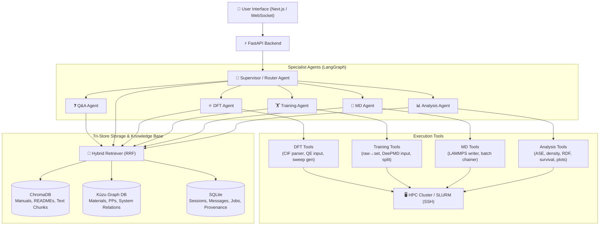

# Scientific Computing Chatbox for Analysis & Active Learning (AL)

> **An AI-powered Agentic RAG platform that automates and orchestrates DFT calculations, Deep Potential model training, LAMMPS molecular dynamics, and interfacial post-processing analysis.**

---

## 🔬 What Are We Doing?

Computational materials science workflows typically require researchers to manually navigate across disparate, complex tools:
- Parsing crystal structures and running Density Functional Theory (**Quantum ESPRESSO**) convergence tests.
- Curating raw DFT data, formatting datasets, and training machine learning potentials (**DeePMD-kit**).
- Setting up long-duration, restart-linked production molecular dynamics (**LAMMPS**) on HPC clusters.
- Processing multi-gigabyte trajectory files (`.extxyz`) to calculate interfacial water density profiles, radial distribution functions (RDF), surface hydroxylation fractions, and survival probabilities.

**This project creates an intelligent, conversational scientific assistant** that bridges these workflows. Instead of manually writing boilerplate input files, managing batch chaining scripts, and editing Jupyter notebooks by hand, the user interacts with an **Agentic RAG-powered chatbox** that:
1. Understands natural language scientific intents.
2. Queries domain knowledge across physics manuals, element pseudopotential tables, and system configurations.
3. Automatically generates, validates, and executes simulation codes and parameter sweeps.
4. Manages and monitors SLURM jobs on HPC clusters via secure SSH tunnels.
5. Ingests finished trajectories, executes post-processing analyses, and visualizes publication-grade figures directly in chat.

---

## 🏛️ System Architecture: Agentic RAG

Standard RAG (retrieval-augmented generation) is static and limited to text summarization. It cannot run multi-step scientific pipelines, validate physical parameters, submit cluster jobs, or self-correct upon simulation failure. 

Our architecture uses **Agentic RAG with LangGraph orchestration** and a **Tri-Store Memory Backend**:



### Why Tri-Store Memory?

| Store | Technology | What It Stores | Why It Is Essential |
|---|---|---|---|
| **Vector DB** | ChromaDB (`nomic-embed-text`) | Quantum ESPRESSO, LAMMPS, and DeePMD manuals; workflow documentation | Semantic search: finds relevant documentation passages even when queries are informally phrased. |
| **Knowledge Graph** | Kùzu DB (Embedded Graph) | Relational facts: `Material → has_pseudo → UPF`, `System → type_map → [H, O]`, `Workflow → steps` | Multi-hop reasoning: resolves exact simulation dependencies (e.g. which pseudopotential and cutoff match Pt). |
| **Relational DB** | SQLite (WAL mode) | Sessions, chat history, SLURM job IDs, runtime status, parameter logs, artifact paths | Provenance & state: tracks job lifecycles, execution history, and exact numerical parameters. |

---

## 🧱 The Four Core Simulation Pillars

```
┌─────────────────┐       ┌─────────────────┐       ┌─────────────────┐       ┌─────────────────┐
│     1. DFT      │  ───> │  2. DeePMD-kit  │  ───> │   3. LAMMPS     │  ───> │   4. Analysis   │
│ Quantum ESPRESSO│       │  Model Training │       │Molecular Dynamic│       │ Post-Processing │
└─────────────────┘       └─────────────────┘       └─────────────────┘       └─────────────────┘
  • CIF parsing             • raw → set conversion    • Batch chaining          • Water density ρ(z)
  • ecutwfc / k-points      • Train/Test splits       • Restart recovery        • Pair RDFs (g(r))
  • pw.in & qe.sub gen      • se_e2_a configs         • Simple/Complex styles   • Survival prob P(t)
  • Convergence plots       • Ensemble seeds          • HPC SLURM sub           • Hydroxyl fractions
```

### 1. ⚛️ Density Functional Theory (DFT)
- **Goal**: Automate Quantum ESPRESSO (`pw.x`) plane-wave self-consistent field (SCF) calculations and convergence checks.
- **Capabilities**:
  - Parses crystal structures from `.cif` files using ASE (`Atomic Simulation Environment`).
  - Generates parameter sweeps for kinetic energy cutoffs (`ecutwfc`) and k-point mesh densities.
  - Automatically creates subdirectories with valid `pw.in` input files and SLURM `qe.sub` scripts.
  - Parses finished output files (`pw.out`) to extract total energies and generates publication-grade convergence plots (`Convergence_<mode>_<structure>.png`).

### 2. 🏋️ Machine Learning Potential Training (DeePMD-kit)
- **Goal**: Prepare DFT trajectory data and train Deep Potential (DP) neural network models.
- **Capabilities**:
  - Scans raw data directories containing `coord.raw`, `box.raw`, `energy.raw`, and `force.raw`.
  - Splits out held-out validation sets (`Test/`).
  - Converts raw text data into binary NumPy compressed batches (`set.000/`, `set.001/`).
  - Builds `input.json` configurations using smooth cutoff interatomic descriptors (`se_e2_a`).
  - Generates seeded multi-model training runs (`DP_Models/<System>/<seed>/`) for ensemble active learning.

### 3. 🔬 Molecular Dynamics (LAMMPS)
- **Goal**: Execute long-timescale production molecular dynamics driven by DeePMD potentials.
- **Capabilities**:
  - Resolves frozen graph models (`graph.pb`) and starting configurations.
  - Supports multiple system configurations (e.g. bulk **Water** at 300 K, **Graphene-Water** / **Metal-Oxide-Water Interfaces** at 330 K).
  - Implements **restart-linked batch chaining** (e.g., 5 ns simulation divided into 500 ps batches) with automated SLURM job dependencies (`sbatch --dependency=afterok:<jobid>`).
  - Protects against HPC walltime aborts with automated restart-writing and timer cutoffs (`timer timeout`).

### 4. 📊 Interfacial Post-Processing & Analysis
- **Goal**: Extract structural and kinetic insights from multi-gigabyte trajectory files (`.extxyz`) of solid-liquid interfaces (e.g. $\text{IrO}_2 / \text{H}_2\text{O}$).
- **Capabilities**:
  - **Surface Site Identification**: Identifies surface metal layers ($M_{\text{sur}}$), bulk lattice oxygens, coordinatively unsaturated sites ($M_{\text{cus}}$), bridge oxygens ($O_{\text{br}}$), and adsorbed water oxygens ($O_{\text{adb}}$).
  - **Mass Density Profiles**: Computes 1D profiles $\rho(z)$ for water oxygen and hydrogen.
  - **Radial Distribution Functions**: Computes pair RDFs ($M_{\text{cus}}\text{-}O_w$, $O_{\text{br}}\text{-}H_w$, $O_{\text{br}}\text{-}O_w$) via `pwtools`.
  - **Hydroxylation & Dissociation Kinetics**: Classifies adsorbed water into molecular $\text{H}_2\text{O}$ vs. dissociated $\text{OH}^-$ groups.
  - **Survival Probability**: Computes time-lagged survival probability $P(t)$ and residence times via numerical integration.
  - **Reporting**: Generates multi-panel figures (`full_analysis_presentation.png`) and quantitative statistical summary reports across model ensembles.

---

## 📁 Repository Layout

```
Chatbox_for_analysis_AL/
├── README.md                             # Project overview and guide (this document)
├── implementation_plan.md                # Comprehensive 10-week technical plan
│
├── backend/                              # Python backend service (FastAPI + LangGraph)
│   ├── pyproject.toml                    # Dependencies & build configuration
│   ├── main.py                           # FastAPI server, REST & WebSocket routes
│   ├── config.py                         # Settings (Ollama URL, paths, HPC config)
│   │
│   ├── db/                               # SQLite storage backend
│   │   ├── __init__.py
│   │   └── models.py                     # Schema: sessions, messages, jobs, parameters
│   │
│   ├── rag/                              # Tri-store RAG components
│   │   ├── __init__.py
│   │   ├── embeddings.py                 # Ollama nomic-embed-text wrapper
│   │   ├── vectorstore.py                # ChromaDB vector store for project docs
│   │   ├── knowledge_graph.py            # Kùzu graph DB with materials & pipeline schema
│   │   └── hybrid_retriever.py           # Reciprocal Rank Fusion (RRF) across stores
│   │
│   ├── agents/                           # LangGraph multi-agent system (in progress)
│   │   ├── __init__.py
│   │   └── (router, dft, training, md, analysis, qa agents)
│   │
│   └── tools/                            # Execution tools for agents
│       ├── __init__.py
│       └── (dft_tools, training_tools, md_tools, analysis_tools, slurm_tools)
│
├── DFT/                                  # Quantum ESPRESSO workflow & reference data
│   ├── Pt.cif                            # Sample crystal structure (Platinum)
│   ├── EnergyCutoffandKpointsScript.ipynb # Original interactive sweep & plotting notebook
│   └── README_EnergyCutoffAndKpoints.md   # Detailed workflow documentation
│
├── Training/                             # DeePMD-kit model training workflow
│   ├── Raw_Files/                        # Raw DFT calculation directories
│   ├── DP_Models/                        # Generated model training folders
│   ├── Training_Script.ipynb             # Raw→set conversion & job generation notebook
│   └── README_Training_Script.md         # Detailed training documentation
│
├── Molecular Dynamics/                   # LAMMPS simulation workflow
│   ├── Frozen_Graphs/                    # Pre-trained DeePMD .pb graph models
│   ├── Starting_Configurations/          # Initial .lmp structure data files
│   ├── Long_Run/                         # Batch-chained simulation directories
│   ├── MD_Simulation_Script.ipynb        # Batch chaining & SLURM script generator
│   └── README_MD_Simulation_Script.md    # Detailed MD documentation
│
└── Analysis/                             # Post-processing & trajectory analysis
    ├── iro2_water_concat.extxyz          # Interface trajectory data
    ├── Water_Density_RDF_...ipynb        # Interfacial analysis & plotting notebook
    └── README_Water_Interface_Analysis.md# Detailed analysis documentation
```

---

## 🚀 Getting Started

### 1. Prerequisites
- **Python**: 3.10 or higher
- **Ollama**: Running locally with the following models pulled:
  ```bash
  ollama pull qwen2.5-coder:7b      # Or qwen3:32b / qwen2.5-coder:32b for high-end GPUs
  ollama pull nomic-embed-text      # Text embedding model for ChromaDB
  ```

### 2. Environment Setup
Install backend dependencies into a virtual environment:
```bash
# Create and activate virtual environment
python -m venv .venv
source .venv/bin/activate    # On Windows: .venv\Scripts\activate

# Install backend dependencies
pip install -e backend/
```

### 3. Running the Backend
Start the FastAPI server:
```bash
uvicorn backend.main:app --host 0.0.0.0 --port 8000 --reload
```

Upon startup, the server automatically:
- Connects to SQLite and initializes tables (`sessions`, `messages`, `jobs`, `parameters`, `artifacts`).
- Connects to Kùzu Graph DB and pre-populates materials, pseudopotentials, and workflow sequences.
- Initializes ChromaDB and ingests domain READMEs with `nomic-embed-text`.
- Prepares the `HybridRetriever` ready for user queries.

### 4. Interacting with the API
- **Health check**:
  ```bash
  # Bash / Mac / Linux
  curl http://localhost:8000/

  # Windows PowerShell
  Invoke-RestMethod http://localhost:8000/
  ```
- **Send a chat query**:
  ```bash
  # Bash / Mac / Linux / Git Bash
  curl -X POST http://localhost:8000/api/chat \
    -H "Content-Type: application/json" \
    -d '{"message": "What pseudopotential is recommended for Platinum in Quantum ESPRESSO?"}'

  # Windows PowerShell (Option 1 - Recommended)
  Invoke-RestMethod -Uri "http://localhost:8000/api/chat" -Method Post -ContentType "application/json" -Body '{"message": "What pseudopotential is recommended for Platinum in Quantum ESPRESSO?"}'

  # Windows PowerShell (Option 2 - curl.exe)
  curl.exe -X POST http://localhost:8000/api/chat -H "Content-Type: application/json" -d '{\"message\": \"What pseudopotential is recommended for Platinum in Quantum ESPRESSO?\"}'
  ```
- **List chat sessions & jobs**:
  ```bash
  curl http://localhost:8000/api/sessions
  curl http://localhost:8000/api/jobs
  ```

---

## 🗺️ Project Roadmap

- [x] **Phase 1: Foundations & Storage**
  - [x] FastAPI core backend with CORS and WebSocket endpoints.
  - [x] SQLite schema for sessions, messages, SLURM jobs, and parameter provenance.
  - [x] ChromaDB persistent vector store with automated document ingestion.
  - [x] Kùzu embedded Knowledge Graph with materials/simulation schema.
  - [x] Reciprocal Rank Fusion (RRF) hybrid retriever.
  - [x] Baseline RAG conversational chat endpoint.
- [ ] **Phase 2: Scientific Tools Integration**
  - [ ] Port `DFT` notebook logic into standalone `dft_tools.py`.
  - [ ] Port `Training` data processing into `training_tools.py`.
  - [ ] Port `MD` batch chaining logic into `md_tools.py`.
  - [ ] Port `Analysis` density/RDF/survival calculations into `analysis_tools.py`.
  - [ ] Implement SSH-based SLURM cluster submission and tracking (`slurm_tools.py`).
- [ ] **Phase 3: LangGraph Agent Orchestration**
  - [ ] Implement supervisor router agent for intent classification.
  - [ ] Build specialized sub-agents (DFT, Training, MD, Analysis, QA).
  - [ ] Integrate human-in-the-loop approvals before file writes or cluster submissions.
  - [ ] Add self-correction loops for simulation convergence issues.
- [ ] **Phase 4: Modern Web Frontend**
  - [ ] Next.js chat interface with dark theme and glassmorphism.
  - [ ] Syntax-highlighted code preview with direct "Submit to HPC" buttons.
  - [ ] Inline interactive plot rendering for analysis figures and convergence curves.
  - [ ] Live SLURM job monitoring dashboard.
- [ ] **Phase 5: Active Learning Closed-Loop Integration**
  - [ ] Trajectory sampling based on model ensemble uncertainty.
  - [ ] Automated loop: MD trajectory → High-uncertainty frame extraction → DFT single-point → DeePMD retrain → Next MD cycle.
