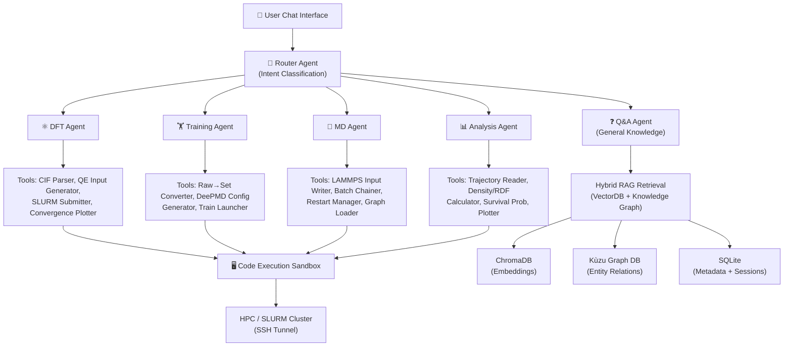
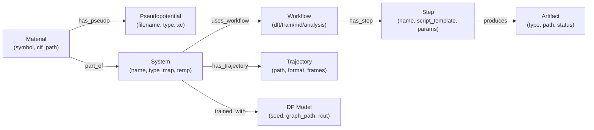
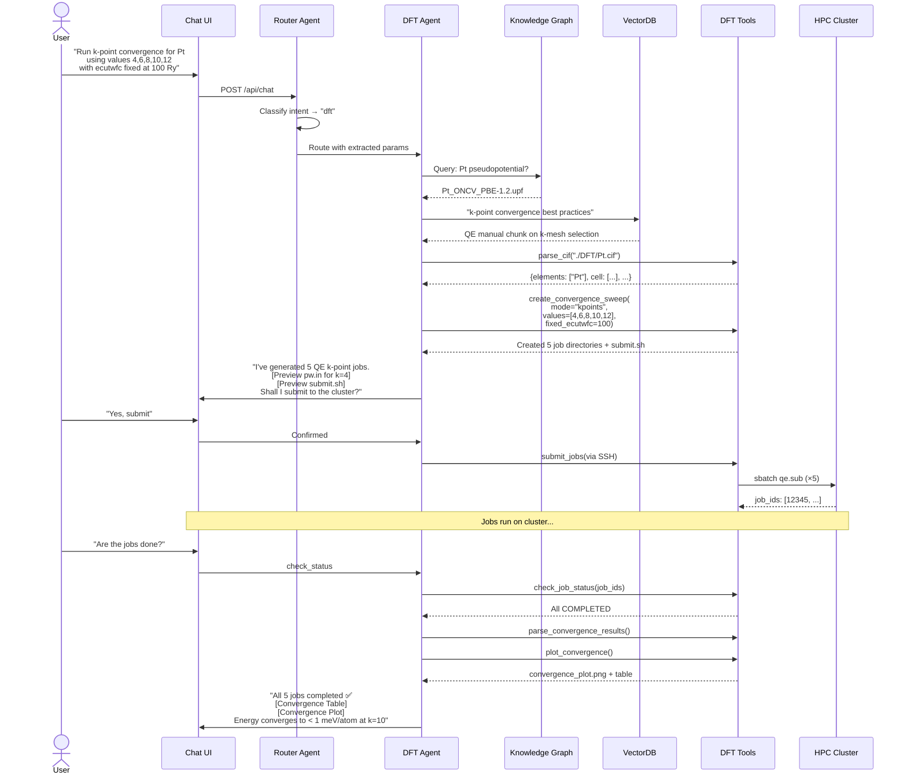

# Scientific Computing Chatbox — Implementation Plan

> An AI-powered chatbox that orchestrates **DFT**, **DeePMD Training**, **LAMMPS Molecular Dynamics**, and **Post-processing Analysis** workflows via open-source LLMs, using Agentic RAG to understand user intent and generate/execute the correct simulation code on trajectory files and structures.

---

## 1. Architecture Decision: Agentic RAG (Not Standard RAG)

> [!IMPORTANT]
> **Verdict: Agentic RAG is the clear choice.** Standard RAG is insufficient for this project.

### Why Standard RAG Fails Here

| Requirement | Standard RAG | Agentic RAG |
|---|---|---|
| Multi-step workflow (DFT → Train → MD → Analyze) | ❌ Single retrieve-and-answer pass | ✅ Plan → Retrieve → Act → Verify loop |
| Code generation + execution (QE inputs, LAMMPS scripts) | ❌ Text retrieval only | ✅ Tool-calling with code execution |
| Parameter validation (k-points, ecutwfc, batch sizes) | ❌ No computational ability | ✅ Agents validate before generating |
| Dynamic routing (which pipeline? what file format?) | ❌ Fixed retrieval path | ✅ Router agent decides dynamically |
| Error recovery (failed SLURM jobs, convergence issues) | ❌ No feedback loop | ✅ Iterative self-correction |

### Agentic RAG Architecture Overview



---

## 2. Storage Backend: Knowledge Graph + VectorDB + SQLite (All Three)

> [!IMPORTANT]
> **Verdict: Use all three — each serves a distinct, non-overlapping role.**

### Role of Each Store

| Store | Technology | What It Stores | Why It's Needed |
|---|---|---|---|
| **VectorDB** | ChromaDB (embedded, no infra) | Chunked documentation, README content, paper excerpts, QE/LAMMPS manual sections, error messages | Semantic search — find relevant docs even when user phrasing doesn't match exact keywords |
| **Knowledge Graph** | Kùzu (embedded graph DB) | Structured domain facts: `Material → has_pseudopotential → Pt_ONCV_PBE-1.2.upf`, `System → uses_typemap → [H, O]`, `Workflow → requires_step → DFT` | Multi-hop reasoning — "What pseudopotential does Pt need?" traverses `Pt → has_element → Pt → has_pseudo → ...` |
| **SQLite** | Python `sqlite3` + `sqlite-vec` | Session history, job metadata (SLURM IDs, status, paths), user preferences, run provenance, parameter logs | Relational queries — "Show me all failed DFT jobs for Pt with ecutwfc > 80 Ry" |

### Why This Combination Beats Any Single Store

1. **VectorDB alone** can't answer "What's the correct `nbnd` for a 4-atom Pt cell?" — it retrieves *similar* text but can't reason over structured relationships.
2. **Knowledge Graph alone** can't find the right documentation passage when the user asks vaguely "my QE job crashed with segfault."
3. **SQLite alone** can't do semantic similarity search and can't represent complex entity relationships naturally.
4. **Together**: The Router Agent queries all three in parallel, fuses results, and passes a rich context to the specialist agent.

### Knowledge Graph Schema (Kùzu)



---

## 3. LLM Selection & Serving

### Recommended Models (via Ollama)

| Role | Model | Size | Why |
|---|---|---|---|
| **Primary Reasoning / Code Gen** | `qwen3:32b` or `qwen2.5-coder:32b` | 32B | Best local model for code generation + scientific reasoning; strong tool-calling support |
| **Fallback / Lightweight** | `qwen3:8b` | 8B | Fast inference for simple routing decisions and parameter extraction |
| **Embedding** | `nomic-embed-text` | 137M | High-quality embeddings for ChromaDB; runs on CPU |

> [!NOTE]
> **Hardware requirement**: 32B models need ~24GB VRAM (RTX 3090/4090 or equivalent). If unavailable, use `qwen3:14b` (needs ~12GB) as a compromise. All models run locally via Ollama — no API keys, no data leaves the machine.

### Alternative: API-Based (if local GPU is insufficient)

If local hardware is a constraint, the system can be configured to use:
- **Groq** (free tier, fast Llama 3.3 70B inference)
- **Together.ai** (Qwen 2.5 72B, cheap)
- **OpenRouter** (multi-model routing)

The architecture is model-agnostic — we abstract the LLM behind a provider interface.

---

## 4. Multi-Agent System Design (LangGraph)

### Why LangGraph Over LangChain/LlamaIndex

- **Stateful graph execution** with checkpointing — crucial for long-running simulation workflows
- **Human-in-the-loop** built-in — user confirms before submitting SLURM jobs
- **Cyclic graphs** — agents can loop back for self-correction
- **Persistent memory** across conversation turns

### Agent Definitions

#### 4.1 Router Agent (Supervisor)
```
Role: Classify user intent → route to specialist agent
Input: User message + conversation history
Output: {agent: "dft"|"training"|"md"|"analysis"|"qa", extracted_params: {...}}

Decision Logic:
- Mentions CIF, ecutwfc, k-points, QE, convergence → DFT Agent
- Mentions raw files, set.*, DeePMD, training, seeds → Training Agent  
- Mentions LAMMPS, trajectory, batch, restart, frozen graph → MD Agent
- Mentions density, RDF, survival, hydroxyl, plot → Analysis Agent
- General question about methods/theory → Q&A Agent (uses RAG)
```

#### 4.2 DFT Agent
```
Tools:
  - parse_cif(path) → structure info (elements, cell, positions)
  - generate_qe_input(structure, ecutwfc, kpoints, pseudo_map) → pw.in content
  - generate_slurm_script(nodes, tasks, partition, walltime, command) → qe.sub
  - create_convergence_sweep(mode, values, fixed_param) → job directories
  - parse_qe_output(path) → energy, forces, convergence status
  - plot_convergence(data) → PNG figure

Knowledge (from KG + VectorDB):
  - Pseudopotential mappings per element
  - Recommended ecutwfc ranges per element family
  - SLURM cluster configuration (nodes, partitions)
```

#### 4.3 Training Agent
```
Tools:
  - scan_raw_files(base_dir, suffix_filter) → list of system directories
  - validate_raw_data(system_dir) → {has_box, has_coord, has_energy, ...}
  - generate_test_split(system_dir, n_test=100) → Test/ directory
  - convert_raw_to_set(directory) → set.000/, set.001/, ...
  - generate_deepmd_input(type_map, descriptor_params, seed) → input.json
  - generate_train_slurm(gpu, walltime) → train.sub

Knowledge:
  - DeePMD descriptor types and their parameter spaces
  - Type maps for different chemical systems (not just H/O)
  - Recommended training hyperparameters by system complexity
```

#### 4.4 MD Agent
```
Tools:
  - resolve_frozen_graphs(model, system, n_graphs) → list of .pb paths
  - validate_starting_config(path) → atom counts, box dimensions
  - generate_lammps_input(system_style, temperature, timestep, ...) → in.lammps
  - create_batch_chain(n_batches, batch_steps, ...) → batch_1/ ... batch_N/
  - generate_submit_from_script(batches) → submit_from.sh
  - check_restart_file(path) → exists, valid

Knowledge:
  - LAMMPS pair_style deepmd syntax and options
  - System-specific parameters (temperatures, atom types, masses)
  - Restart chaining logic
```

#### 4.5 Analysis Agent
```
Tools:
  - load_trajectory(path, format) → ASE Atoms list + metadata
  - identify_surface_sites(frame, metal_symbol, o_stoich) → site classifications
  - compute_density_profile(trajectory, bin_width) → density arrays
  - compute_rdf(trajectory, pairs, dr) → g(r) arrays
  - compute_survival_probability(trajectory, site_type, lags) → P(t)
  - compute_hydroxyl_fraction(trajectory, cutoff) → fraction arrays
  - generate_combined_plot(results) → 2×2 PNG
  - generate_summary_report(results) → text report

Knowledge:
  - Bond cutoff values for different metal-oxide systems
  - Physical constants and unit conversions
  - Plot styling conventions for publication
```

#### 4.6 Q&A Agent (General Knowledge)
```
Retrieval: Hybrid (VectorDB semantic search + KG entity lookup)
Purpose: Answer conceptual questions about DFT, MD, DeePMD, materials science
         without executing any code
```

---

## 5. Proposed Directory Structure

```
Chatbox_for_analysis_AL/
├── app/                          # [NEW] Web application (Next.js)
│   ├── package.json
│   ├── next.config.js
│   ├── public/
│   ├── src/
│   │   ├── app/
│   │   │   ├── layout.tsx        # Root layout with dark theme
│   │   │   ├── page.tsx          # Chat interface
│   │   │   └── api/
│   │   │       ├── chat/route.ts       # Chat endpoint
│   │   │       └── jobs/route.ts       # Job status endpoint
│   │   ├── components/
│   │   │   ├── ChatWindow.tsx    # Main chat UI
│   │   │   ├── MessageBubble.tsx # Message rendering (code, plots, tables)
│   │   │   ├── Sidebar.tsx       # Workflow selector + job history
│   │   │   ├── CodePreview.tsx   # Generated code preview + confirm
│   │   │   ├── PlotViewer.tsx    # Inline matplotlib/plotly output
│   │   │   └── JobMonitor.tsx    # SLURM job status dashboard
│   │   └── lib/
│   │       ├── api.ts            # Backend API client
│   │       └── types.ts          # TypeScript interfaces
│   └── index.css                 # Design system
│
├── backend/                      # [NEW] Python backend (FastAPI)
│   ├── pyproject.toml
│   ├── main.py                   # FastAPI app entry
│   ├── config.py                 # Settings (Ollama URL, DB paths, HPC config)
│   │
│   ├── agents/                   # LangGraph agent definitions
│   │   ├── __init__.py
│   │   ├── router.py             # Router/Supervisor agent
│   │   ├── dft_agent.py          # DFT specialist
│   │   ├── training_agent.py     # Training specialist
│   │   ├── md_agent.py           # MD specialist
│   │   ├── analysis_agent.py     # Analysis specialist
│   │   └── qa_agent.py           # General Q&A agent
│   │
│   ├── tools/                    # Agent tools (Python functions)
│   │   ├── __init__.py
│   │   ├── dft_tools.py          # CIF parsing, QE input gen, convergence
│   │   ├── training_tools.py     # Raw→set, DeePMD config, splits
│   │   ├── md_tools.py           # LAMMPS input, batch chains, restarts
│   │   ├── analysis_tools.py     # Density, RDF, survival, plotting
│   │   ├── slurm_tools.py        # SLURM submission & monitoring (SSH)
│   │   └── file_tools.py         # File I/O, path resolution, validation
│   │
│   ├── rag/                      # RAG infrastructure
│   │   ├── __init__.py
│   │   ├── vectorstore.py        # ChromaDB setup + document ingestion
│   │   ├── knowledge_graph.py    # Kùzu schema + CRUD operations
│   │   ├── hybrid_retriever.py   # Fused retrieval (vector + graph + SQL)
│   │   └── embeddings.py         # Embedding model wrapper (nomic-embed)
│   │
│   ├── db/                       # SQLite database
│   │   ├── __init__.py
│   │   ├── models.py             # SQLAlchemy/raw models (sessions, jobs, params)
│   │   ├── migrations.py         # Schema setup
│   │   └── chatbox.db            # SQLite database file (auto-created)
│   │
│   ├── knowledge/                # Knowledge base source documents
│   │   ├── qe_manual_chunks/     # Quantum ESPRESSO manual excerpts
│   │   ├── lammps_manual_chunks/ # LAMMPS manual excerpts
│   │   ├── deepmd_docs/          # DeePMD-kit documentation
│   │   └── workflow_templates/   # Your existing notebook logic as docs
│   │
│   └── sandbox/                  # Code execution sandbox
│       ├── __init__.py
│       └── executor.py           # Safe code execution (subprocess, Docker)
│
├── Analysis/                     # [EXISTING] — unchanged
├── DFT/                          # [EXISTING] — unchanged
├── Molecular Dynamics/           # [EXISTING] — unchanged
└── Training/                     # [EXISTING] — unchanged
```

---

## 6. Detailed Proposed Changes

### Component 1: Backend Core (FastAPI)

#### [NEW] [main.py](file:///d:/Chatbox%20Lab/Chatbox_for_analysis_AL/backend/main.py)
- FastAPI application with WebSocket support for streaming chat responses
- CORS middleware for Next.js frontend
- Endpoints: `POST /api/chat` (message), `GET /api/jobs` (status), `WS /ws/chat` (streaming)
- Lifespan handler to initialize Ollama connection, ChromaDB, Kùzu, and SQLite on startup

#### [NEW] [config.py](file:///d:/Chatbox%20Lab/Chatbox_for_analysis_AL/backend/config.py)
- Pydantic Settings model with:
  - `OLLAMA_BASE_URL` (default: `http://localhost:11434`)
  - `MODEL_NAME` (default: `qwen3:32b`)
  - `EMBEDDING_MODEL` (default: `nomic-embed-text`)
  - `CHROMA_PERSIST_DIR`, `KUZU_DB_DIR`, `SQLITE_PATH`
  - `HPC_HOST`, `HPC_USER`, `HPC_KEY_PATH` (for SSH-based SLURM submission)
  - `WORKSPACE_ROOT` (points to `d:/Chatbox Lab/Chatbox_for_analysis_AL/`)

---

### Component 2: Agent System (LangGraph)

#### [NEW] [router.py](file:///d:/Chatbox%20Lab/Chatbox_for_analysis_AL/backend/agents/router.py)
- LangGraph `StateGraph` with nodes: `classify_intent`, `route`, `dft`, `training`, `md`, `analysis`, `qa`, `respond`
- State schema: `{messages, intent, agent, tool_results, pending_confirmation}`
- Conditional edges based on intent classification
- Human-in-the-loop checkpoint before any destructive action (file writes, SLURM submission)

#### [NEW] [dft_agent.py](file:///d:/Chatbox%20Lab/Chatbox_for_analysis_AL/backend/agents/dft_agent.py)
- Wraps the logic from [EnergyCutoffandKpointsScript.ipynb](file:///d:/Chatbox%20Lab/Chatbox_for_analysis_AL/DFT/EnergyCutoffandKpointsScript.ipynb) into callable tools
- Parameterizes hardcoded values: pseudopotential dict, `nbnd`, k-mesh, partition names
- Supports arbitrary elements (not just Pt) by querying the Knowledge Graph for pseudo mappings

#### [NEW] [training_agent.py](file:///d:/Chatbox%20Lab/Chatbox_for_analysis_AL/backend/agents/training_agent.py)
- Wraps the logic from [Training_Script.ipynb](file:///d:/Chatbox%20Lab/Chatbox_for_analysis_AL/Training/Training_Script.ipynb)
- Extends `_Water` suffix filter to be configurable per system
- Dynamic `type_map` resolution via Knowledge Graph (not hardcoded `["H", "O"]`)

#### [NEW] [md_agent.py](file:///d:/Chatbox%20Lab/Chatbox_for_analysis_AL/backend/agents/md_agent.py)
- Wraps the logic from [MD_Simulation_Script.ipynb](file:///d:/Chatbox%20Lab/Chatbox_for_analysis_AL/Molecular%20Dynamics/MD_Simulation_Script.ipynb)
- Validates frozen graph existence before generating job scripts
- Supports both `simple` and `complex` LAMMPS styles with configurable parameters

#### [NEW] [analysis_agent.py](file:///d:/Chatbox%20Lab/Chatbox_for_analysis_AL/backend/agents/analysis_agent.py)
- Wraps the logic from the [Analysis notebook](file:///d:/Chatbox%20Lab/Chatbox_for_analysis_AL/Analysis/Water_Density_RDF_Survival_Probability_Hydroxyl_Fraction_with_IrO2_Template_Seperate_Plot_Capability.ipynb)
- Parameterizes: metal symbol, O stoichiometry, bond cutoffs, dump intervals
- Fixes the known OD/D₂O mislabeling issue
- Makes site identification consistent between density/RDF and survival/fraction cells

#### [NEW] [qa_agent.py](file:///d:/Chatbox%20Lab/Chatbox_for_analysis_AL/backend/agents/qa_agent.py)
- Uses hybrid retriever (ChromaDB + Kùzu) to answer conceptual questions
- Falls back to LLM's parametric knowledge when retrieval returns low-confidence results

---

### Component 3: Tools

#### [NEW] [dft_tools.py](file:///d:/Chatbox%20Lab/Chatbox_for_analysis_AL/backend/tools/dft_tools.py)
Key functions (registered as LangGraph tools):
- `parse_cif(cif_path: str) → dict` — reads CIF via ASE, returns elements, cell params, positions
- `generate_qe_scf_input(structure, ecutwfc, kpoints, pseudo_map, nbnd, smearing, degauss) → str` — generates `pw.in` content
- `create_convergence_sweep(cif_path, mode, values, fixed_param) → list[Path]` — creates job directories
- `parse_convergence_results(sweep_dir) → DataFrame` — reads `pw.out` files, returns energy table
- `plot_convergence(df, mode, save_path) → str` — generates publication-quality convergence plot

#### [NEW] [training_tools.py](file:///d:/Chatbox%20Lab/Chatbox_for_analysis_AL/backend/tools/training_tools.py)
- `scan_raw_systems(base_dir, suffix) → list[dict]` — finds training data directories
- `create_test_split(system_dir, n_samples) → Path` — random hold-out split
- `raw_to_set(directory, chunk_size) → list[Path]` — converts `.raw` → `set.*/` via numpy
- `generate_deepmd_config(type_map, sel, descriptor, fitting, lr, loss, training) → dict` — builds `input.json`
- `create_training_jobs(system_dir, n_models, seeds) → list[Path]` — creates seeded job directories

#### [NEW] [md_tools.py](file:///d:/Chatbox%20Lab/Chatbox_for_analysis_AL/backend/tools/md_tools.py)
- `validate_frozen_graphs(graph_dir, model, system, n_graphs) → list[Path]`
- `generate_lammps_input(style, system_params, batch_num, ...) → str`
- `create_batch_chain(output_dir, n_batches, batch_steps, ...) → list[Path]`
- `generate_submit_chain_script(batch_dirs) → str`
- `check_md_status(batch_dir) → dict` — checks for restart files, log tails, errors

#### [NEW] [analysis_tools.py](file:///d:/Chatbox%20Lab/Chatbox_for_analysis_AL/backend/tools/analysis_tools.py)
- `load_extxyz_trajectory(path, stride) → list[Atoms]`
- `identify_sites(frame, metal, o_stoich) → dict` — classifies M_sur, O_bulk, O_w, CUS, O_adb, O_sur, O_br
- `compute_density_profile(traj, bin_width, cell) → dict`
- `compute_pair_rdf(traj, pairs, dr) → dict`
- `compute_survival_probability(traj, site_type, n_lags) → dict`
- `compute_hydroxyl_fraction(traj, oh_cutoff) → dict`
- `plot_combined_2x2(results, save_path) → str`
- `generate_text_report(results) → str`

#### [NEW] [slurm_tools.py](file:///d:/Chatbox%20Lab/Chatbox_for_analysis_AL/backend/tools/slurm_tools.py)
- `submit_job(host, script_path, user, key) → job_id` — SSH + sbatch
- `check_job_status(host, job_id) → dict` — sacct/squeue parsing
- `cancel_job(host, job_id) → bool`
- `get_job_log(host, job_id, tail_lines) → str`

---

### Component 4: RAG Infrastructure

#### [NEW] [vectorstore.py](file:///d:/Chatbox%20Lab/Chatbox_for_analysis_AL/backend/rag/vectorstore.py)
- ChromaDB persistent client initialization
- Document ingestion pipeline:
  1. Load your 4 READMEs + QE/LAMMPS/DeePMD manual sections
  2. Chunk with `RecursiveCharacterTextSplitter` (chunk_size=1000, overlap=200)
  3. Embed with `nomic-embed-text` via Ollama
  4. Store with metadata (source_file, workflow_type, section)
- `semantic_search(query, n_results, filter) → list[Document]`

#### [NEW] [knowledge_graph.py](file:///d:/Chatbox%20Lab/Chatbox_for_analysis_AL/backend/rag/knowledge_graph.py)
- Kùzu embedded graph database
- Schema creation (nodes: Material, System, Workflow, Step, Model, Pseudopotential, Trajectory, Artifact)
- Pre-populated with domain knowledge:
  - Element → pseudopotential mappings (extensible beyond Pt)
  - System → type_map mappings (Water: `[H, O]`, Interface: `[O, H, C]`)
  - Workflow → step sequences (DFT → Training → MD → Analysis)
  - System → temperature/parameter defaults
- `graph_query(cypher_query) → list[dict]`
- `entity_lookup(entity_type, filters) → list[dict]`

#### [NEW] [hybrid_retriever.py](file:///d:/Chatbox%20Lab/Chatbox_for_analysis_AL/backend/rag/hybrid_retriever.py)
- Fuses results from ChromaDB (semantic), Kùzu (structured), and SQLite (relational)
- Reciprocal Rank Fusion (RRF) to merge ranked lists
- Returns unified context dict for the agent's prompt

#### [NEW] [embeddings.py](file:///d:/Chatbox%20Lab/Chatbox_for_analysis_AL/backend/rag/embeddings.py)
- Wrapper around Ollama's embedding endpoint
- Caches embeddings to avoid redundant calls
- Supports batch embedding for document ingestion

---

### Component 5: SQLite Database

#### [NEW] [models.py](file:///d:/Chatbox%20Lab/Chatbox_for_analysis_AL/backend/db/models.py)
Tables:
- `sessions` — (id, created_at, title, last_message_at)
- `messages` — (id, session_id, role, content, timestamp, agent_used, tool_calls_json)
- `jobs` — (id, session_id, workflow_type, slurm_job_id, status, submitted_at, completed_at, params_json, output_path)
- `parameters` — (id, job_id, key, value, unit) — tracks all simulation parameters for provenance
- `artifacts` — (id, job_id, type, path, description) — plots, reports, input files generated

---

### Component 6: Web Frontend (Next.js)

#### [NEW] [ChatWindow.tsx](file:///d:/Chatbox%20Lab/Chatbox_for_analysis_AL/app/src/components/ChatWindow.tsx)
- Full-height chat interface with:
  - Dark theme with glassmorphism effects
  - Message bubbles with syntax-highlighted code blocks (for generated QE/LAMMPS inputs)
  - Inline plot rendering (base64-encoded PNGs from analysis tools)
  - "Confirm & Execute" buttons for file writes and SLURM submissions
  - Streaming responses via WebSocket
  - File upload drop zone (for CIF files, trajectory files, raw data)

#### [NEW] [Sidebar.tsx](file:///d:/Chatbox%20Lab/Chatbox_for_analysis_AL/app/src/components/Sidebar.tsx)
- Workflow quick-launch buttons (DFT, Training, MD, Analysis)
- Chat session history
- Active job monitor (polls `/api/jobs`)

#### [NEW] [CodePreview.tsx](file:///d:/Chatbox%20Lab/Chatbox_for_analysis_AL/app/src/components/CodePreview.tsx)
- Side-by-side diff view when modifying existing scripts
- Copy-to-clipboard, download, and "Submit to HPC" actions
- Syntax highlighting for Python, LAMMPS input, QE input, JSON

#### [NEW] [PlotViewer.tsx](file:///d:/Chatbox%20Lab/Chatbox_for_analysis_AL/app/src/components/PlotViewer.tsx)
- Interactive plot viewer (zoom, pan)
- Download as PNG/SVG
- Comparison mode (overlay multiple convergence curves)

---

## 7. Data Flow: Example End-to-End Interaction

### Scenario: "Run a k-point convergence test for Pt"



---

## 8. Phased Implementation Roadmap

### Phase 1: Foundation (Week 1-2)
- [ ] Set up Python backend (FastAPI + project structure)
- [ ] Set up Ollama with chosen models
- [ ] Implement SQLite database schema
- [ ] Implement ChromaDB vector store with README ingestion
- [ ] Implement Kùzu knowledge graph with initial domain data
- [ ] Build the hybrid retriever
- [ ] Create basic Q&A agent (to validate RAG pipeline end-to-end)

### Phase 2: Agent Tools (Week 3-4)
- [ ] Extract notebook logic into Python tool functions:
  - [ ] DFT tools (from `EnergyCutoffandKpointsScript.ipynb`)
  - [ ] Training tools (from `Training_Script.ipynb`)
  - [ ] MD tools (from `MD_Simulation_Script.ipynb`)
  - [ ] Analysis tools (from the Analysis notebook)
- [ ] Write unit tests for each tool function
- [ ] Implement SLURM tools (SSH-based submission + monitoring)

### Phase 3: Agent Orchestration (Week 5-6)
- [ ] Build LangGraph state machine (router + specialist agents)
- [ ] Implement human-in-the-loop confirmation flow
- [ ] Wire tools into agents with proper prompt engineering
- [ ] Test multi-turn conversations for each workflow
- [ ] Add error handling and self-correction loops

### Phase 4: Web Frontend (Week 7-8)
- [ ] Initialize Next.js project
- [ ] Build chat interface with dark theme + glassmorphism
- [ ] Implement WebSocket streaming for real-time responses
- [ ] Build code preview, plot viewer, and job monitor components
- [ ] File upload handling (CIF, extxyz, raw files)
- [ ] Connect frontend to backend API

### Phase 5: Polish & Integration (Week 9-10)
- [ ] End-to-end testing of all 4 workflows through the chat interface
- [ ] Populate knowledge graph with comprehensive domain data
- [ ] Add more documentation chunks to vector store
- [ ] Performance optimization (response streaming, embedding caching)
- [ ] Error handling and user-friendly error messages
- [ ] Deploy documentation and usage guide

---

## User Review Required

> [!IMPORTANT]
> **HPC Access**: The SLURM tools require SSH access to the HPC cluster. Please confirm:
> 1. Can we use SSH key-based auth to connect to the cluster from the machine running this chatbox?
> 2. What is the cluster hostname and your SLURM username?
> 3. Are there any firewall/VPN restrictions?

> [!WARNING]
> **GPU for LLM**: Running `qwen3:32b` locally requires ~24GB VRAM. Please confirm your available GPU. If insufficient, we can:
> - Use a smaller model (`qwen3:14b` at ~12GB, or `qwen3:8b` at ~6GB)
> - Use a cloud API (Groq, Together.ai) — costs money but no local GPU needed
> - Use a hybrid approach (small model for routing, API for complex reasoning)

## Open Questions

> [!IMPORTANT]
> 1. **Deployment target**: Will this chatbox run on your local workstation, or on a server accessible to your lab? This affects the Next.js deployment strategy.

> [!IMPORTANT]
> 2. **Existing notebooks**: Should the existing `.ipynb` files be preserved as-is (chatbox wraps their logic), or can we refactor them into Python modules that both the chatbox and notebooks can import?

> [!NOTE]
> 3. **Additional workflows**: Beyond the 4 current workflows (DFT, Training, MD, Analysis), do you plan to add more (e.g., NEB calculations, phonon calculations, active learning loops)? This affects how extensible we make the agent router.

> [!NOTE]
> 4. **Multi-user support**: Will multiple researchers use this simultaneously, or is it single-user? Affects session management and job ownership.

> [!NOTE]
> 5. **Trajectory file sizes**: The Analysis notebook works with a 4GB `.extxyz` file. Should the chatbox support uploading such large files through the web UI, or should it reference files already on the filesystem/cluster?

---

## Verification Plan

### Automated Tests
```bash
# Backend unit tests (each tool function)
pytest backend/tests/test_dft_tools.py
pytest backend/tests/test_training_tools.py
pytest backend/tests/test_md_tools.py
pytest backend/tests/test_analysis_tools.py

# Agent integration tests (mocked LLM responses)
pytest backend/tests/test_agents.py

# RAG retrieval quality tests
pytest backend/tests/test_retriever.py

# API endpoint tests
pytest backend/tests/test_api.py
```

### Manual Verification
1. **DFT workflow**: Ask chatbot to run a k-point convergence test for Pt → verify generated `pw.in` matches expected format → verify SLURM submission → verify convergence plot
2. **Training workflow**: Ask chatbot to set up training for a Water system with 3 models → verify `input.json` parameters → verify test split is correct
3. **MD workflow**: Ask chatbot to set up a 5 ns Water MD run in 500 ps batches → verify batch chaining logic → verify `submit_from.sh` dependency chain
4. **Analysis workflow**: Ask chatbot to compute density profiles and RDFs for IrO₂/water → verify plots match existing notebook output
5. **Cross-workflow Q&A**: Ask "What pseudopotential should I use for Ir?" → verify KG retrieval + correct answer
